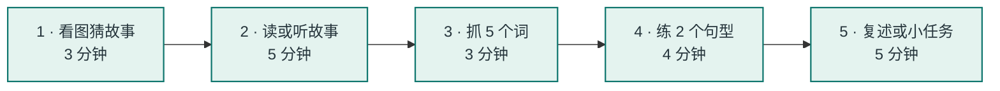

  G
  
PARENT &amp; TEACHER GUIDE

  <h1>家长 / 老师指南</h1>
  
每次 15–20 分钟，把故事变成对话

  

    亲子共读
    课堂活动
    提问模板
    Home Fun
  

## 一个单元的 5 个步骤

> **核心不是“讲完”，而是“聊起来”**。孩子能用中文说出故事发生了什么，就已经完成了理解；英语句子是下一步。

## 读前 / 读中 / 读后怎么问

| 阶段 | 问题模板 | 目的 |
| --- | --- | --- |
| 读前 | Look at the picture. Who can you see? What are they doing? | 激活兴趣，猜情节 |
| 读中 | What is he looking for? Is she happy or sad? Where is the…? | 跟着故事走 |
| 读后 | What happened? What did you like? What would you do? | 复述 + 联系自己 |

孩子用中文回答也完全可以。家长可以把他说的关键词换成英文，再重复一遍。

## 一个例子：Unit 1 Counting

  

    <strong>读前</strong>
    
看封面图：<em>Who can you see? What is the dog doing?</em> 孩子：一个男孩和一只狗，狗在玩鞋子。

  

  

    <strong>读中</strong>
    
读到 Sam 叼鞋时问：<em>Is Ben happy? What does Ben want?</em> 让孩子指图找 blue shoe / red boot。

  

  

    <strong>读后</strong>
    
问：<em>What does Ben say to Sam?</em> 一起说：<strong>“Good dog! Well done!”</strong>

  

  

    <strong>小任务</strong>
    
把家里的鞋打乱，用 <em>“My … shoe, please!”</em> 要回来，数一数有几双。

  

## 四个“不要”

<ul class="checklist">
  <li><strong>不要逐字翻译。</strong>先让孩子猜，再给关键词的意思。</li>
  <li><strong>不要一次背完整词表。</strong>一个单元挑 5–8 个词，放进句子里。</li>
  <li><strong>不要急着纠音。</strong>先鼓励开口，再轻轻重复正确说法。</li>
  <li><strong>不要问“记住了吗”。</strong>改成“你能用这个词说一句话吗？”</li>
</ul>

## 老师课堂版（40 分钟）

| 时间 | 活动 | 做什么 |
| --- | --- | --- |
| 0–5 分钟 | Warm-up | 看图预测、复习主题词 |
| 5–15 分钟 | Story | 讲故事 / 听音频，配合动作和表情 |
| 15–22 分钟 | Comprehension | 用故事地图排序、判断对错、找人名 |
| 22–32 分钟 | Language | 句型卡替换练习、 pair work |
| 32–38 分钟 | Task | 角色扮演、复述、手工或 Starters 小题 |
| 38–40 分钟 | Wrap-up | 说价值句，布置 Home Fun |

## Home Fun Booklet 对应

| 单元 | Home Fun 主题 | 页码 |
| --- | --- | --- |
| 1 Counting | Numbers | 4–5 |
| 2 Come and play | Toys / Review | 6–7, 12–13 |
| 3 Kim's birthday | Family / Review | 8–9, 12–13 |
| 4 Hugo's school bag | School / Review | 10–11, 12–13 |
| 5 What am I? | Animals / Review | 14–15, 22–23 |
| 6 Grandma's glasses | Home / Review | 16–17, 22–23 |
| 7 Let's go there now! | Sports / Review | 18–19, 22–23 |
| 8 Not today! | Food / Review / Let's have fun! | 20–25 |

  给家长的一句话
  
如果今天孩子只学会了一句 <strong>“Come and play!”</strong>，并且真的用它邀请了别人，这比记住 20 个单词更有价值。

## 🔗 相关链接

- <a href="#/map">学习地图</a>：看 8 个单元怎么排。
- <a href="#/sources">原书资料</a>：打开 Student's Book / Teacher's Book / Home Fun。
- <a href="https://github.com/wangwx2019/storyfun" target="_blank" rel="noopener">GitHub 仓库</a>：查看原始 Markdown。
