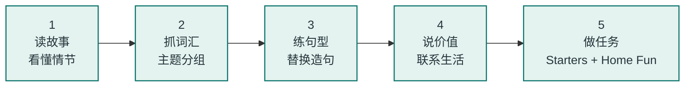

  STORYFUN 1 · 8 STORIES
  <h1>把一本英语故事书，拆成<em>孩子能读懂</em>的小块</h1>
  
不逐字翻译，不硬背单词。每个单元用故事线、词汇包、句型卡、价值点和小任务拆开，最后顺手做一页 Home Fun 练习。

  

    <a class="btn btn-primary" href="#/unit-1">从第 1 单元开始 →</a>
    <a class="btn btn-ghost" href="#/map">先看学习地图</a>
    <a class="btn btn-ghost" href="#/guide">家长怎么用</a>
  

## 这本书在讲什么？

**Storyfun 1** 是剑桥少儿英语（YLE Starters）的故事型教材。全书 8 个故事，每个故事约 8 页，围着孩子熟悉的生活转：数字、玩具、生日、学校、动物、家庭、运动、买东西。

每个单元都不是“先背单词再读课文”，而是：

  
1<strong>先读故事</strong>
跟着人物和图画，猜懂大概意思。

  
2<strong>再抓词汇</strong>
把单词按主题分组，不孤立记忆。

  
3<strong>练熟句型</strong>
用书里的句子换词造句，马上开口。

  
4<strong>做任务 + Home Fun</strong>
复述、表演、画画，最后完成单元页末的 Home Fun 练习。

## 学习路线

> **一句话原则**：每个单元先问“故事讲了什么”，再问“这句话怎么说”，最后问“和我有什么关系”。

## 8 个故事

  <a class="unit-card" href="#/unit-1">
    01NUMBERS · COLOURS
    <h3>Counting</h3>数一数，找一找
    数字 1–10My name's…
  </a>
  <a class="unit-card" href="#/unit-2">
    02TOYS · PETS
    <h3>Come and play</h3>来和我们一起玩
    have gotCome and play!
  </a>
  <a class="unit-card" href="#/unit-3">
    03FAMILY · BIRTHDAY
    <h3>Kim's birthday</h3>Kim 的生日
    家庭Let's…
  </a>
  <a class="unit-card" href="#/unit-4">
    04SCHOOL · SHARING
    <h3>Hugo's school bag</h3>Hugo 的书包
    学校Where's…?
  </a>
  <a class="unit-card" href="#/unit-5">
    05ANIMALS · BODY
    <h3>What am I?</h3>猜猜我是什么？
    动物Can you…?
  </a>
  <a class="unit-card" href="#/unit-6">
    06HOME · HELPING
    <h3>Grandma's glasses</h3>奶奶的眼镜
    方位I can help!
  </a>
  <a class="unit-card" href="#/unit-7">
    07SPORTS · LIKES
    <h3>Let's go there now!</h3>现在就去那儿！
    运动Do you like…?
  </a>
  <a class="unit-card" href="#/unit-8">
    08FOOD · SHOPPING
    <h3>Not today!</h3>今天不行！
    购物Can I have…?
  </a>

## 怎么用这个网站？

  
<strong>👧 给孩子看</strong>
先看图猜故事，再读“故事地图”，最后挑 3 个句型开口说。

  
<strong>👨‍👩‍👧 给家长看</strong>
用“家长 / 老师指南”里的 5 步流程，每次 15–20 分钟就够。

  
<strong>🧑‍🏫 给老师看</strong>
每个单元都标了 Starters 题型对应，可以直接拿去做课堂任务。

  
<strong>📝 学完就练</strong>
每个单元页末都有 Home Fun 练习页；答案折叠在下面，做完再展开。

  
<strong>📚 想核对原文</strong>
“原书资料”里有 Student's Book、Teacher's Book、Home Fun 的链接。

---

说明：本站是学习笔记，不是教材替代品。故事梗概和教学建议根据原书内容整理，文字经过简化与中文解释。

