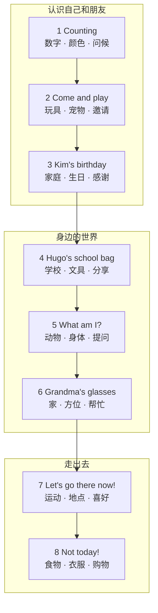
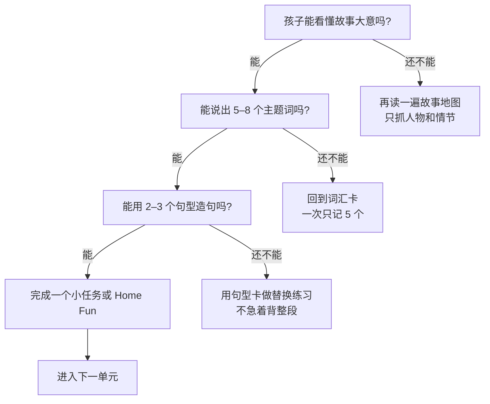

# 学习地图

Storyfun 1 的 8 个单元不是随便排的：从“介绍自己”开始，慢慢走到“在学校、家里、运动场和商店里交流”。这张地图帮你决定：**先学哪个、怎么串起来。**

## 8 个单元的位置

## 一张表看懂

| 单元 | 主题 | 核心句型 | 价值 |
| --- | --- | --- | --- |
| 1 Counting | 数字 1–10、颜色、问候 | My name's… / What's your name? / How many…? | 鼓励别人 |
| 2 Come and play | 玩具、宠物、颜色 | I've got… / We've got… / Come and play! | 交朋友 |
| 3 Kim's birthday | 家庭、食物、生日 | This is my… / Let's… / How old…? | 感谢 |
| 4 Hugo's school bag | 学校、文具 | Where's…? / Here's… / Here you are! | 分享 |
| 5 What am I? | 动物、身体、颜色 | Can you…? / I can… / a / an | 提问是好事 |
| 6 Grandma's glasses | 家、衣服、方位 | on / in / under / next to | 帮助别人 |
| 7 Let's go there now! | 运动、地点、时间 | Do you like…? / Yes, I do. / No, I don't. | 接受不同 |
| 8 Not today! | 食物、衣服、动物 | Can I / we have…? / this / these | 学会道歉 |

## 三条使用路线

  
A<strong>零基础 · 顺着学</strong>
1 → 2 → 3 → 4 → 5 → 6 → 7 → 8。每单元 2–3 次，每次 15–20 分钟。

  
B<strong>有兴趣 · 挑着学</strong>
喜欢动物先学 5，喜欢运动先学 7，喜欢买东西先学 8。主题先行，不容易抗拒。

  
C<strong>备考 · 按题型学</strong>
听力弱练 1、2、3、4；阅读弱练 2、3、5、6、8；口语弱练 1、4、6、7。

## Starters 题型分布

| 试卷 | 题型 | 对应单元 |
| --- | --- | --- |
| Listening | Part 1 连线 | 4, 8 |
| Listening | Part 2 数字 / 名字 | 1, 7 |
| Listening | Part 3 选图 | 1 |
| Listening | Part 4 涂色 | 2, 3, 5, 6 |
| Reading & Writing | Part 1 判断 ✓ / × | 2 |
| Reading & Writing | Part 2 写 yes / no | 2, 3, 8 |
| Reading & Writing | Part 3 字母重组 | 5, 6 |
| Reading & Writing | Part 4 填名词 | 8 |
| Reading & Writing | Part 5 看图回答 | 6 |
| Speaking | Part 1 指图 / 放卡片 | 1, 4, 6 |
| Speaking | Part 2 看图回答 | 2, 3, 5 |
| Speaking | Part 3 物品卡片 | 7 |
| Speaking | Part 4 个人问题 | 4, 5, 7 |

## 怎么判断“可以进入下一单元”？

> **别追求“全记住”**：Storyfun 1 的目标是建立故事阅读的习惯和开口的勇气。一个单元能留下 3 个词、2 个句子，就已经很好了。
