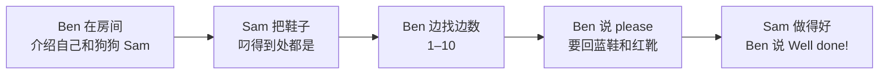

  01
  
UNIT 01 · STUDENT'S BOOK PAGES 4–11

  <h1>Counting</h1>
  
数一数，找一找

  

    数字 1–10
    颜色
    鞋子 / 衣物
    问候与介绍
  

> **一句话故事**：Ben 的狗狗 Sam 把他的鞋子叼得到处都是。Ben 一边找鞋，一边从 1 数到 10，最后夸 Sam：“Well done!”

## 🎯 学完能做到

<ul class="checklist">
  <li>用 <strong>My name's… / I'm…</strong> 介绍自己。</li>
  <li>用 <strong>What's your name?</strong> 问别人名字。</li>
  <li>用 <strong>How many…?</strong> 问数量，并数 1–10。</li>
  <li>说出红、蓝、黑三种颜色和 shoe / boots。</li>
</ul>

## 📖 故事地图

  👦 Ben
  🐶 Sam
  👟 blue shoe
  🥾 red boot

## 🔤 核心词汇

### 人和问候

  
<b>boy</b><small>男孩</small>

  
<b>girl</b><small>女孩</small>

  
<b>friend</b><small>朋友</small>

  
<b>hello / hi</b><small>你好</small>

  
<b>bye / goodbye</b><small>再见</small>

### 数字

  
<b>one – five</b><small>1–5</small>

  
<b>six – ten</b><small>6–10</small>

  
<b>count</b><small>数数</small>

  
<b>again</b><small>再一次</small>

### 颜色和衣物

  
<b>red</b><small>红色</small>

  
<b>blue</b><small>蓝色</small>

  
<b>black</b><small>黑色</small>

  
<b>shoe</b><small>鞋子</small>

  
<b>boots</b><small>靴子</small>

### 动作和夸赞

  
<b>play</b><small>玩</small>

  
<b>wave</b><small>挥手</small>

  
<b>silly</b><small>傻乎乎的</small>

  
<b>good</b><small>好的</small>

  
<b>great</b><small>很棒</small>

  
<b>right</b><small>对的</small>

  
完整词汇表（来自教师用书）

bird, black, blue, boots, boy, bye, cat, count, Dan, dog, Eva, fish, friend, girl, good, goodbye, great, he, hello, hi, phone, please, red, right, she, shoe, silly, wave

## 💬 重点句型

  
My name's Ben. I'm your friend.

  
我叫 Ben，我是你的朋友。

  
What's your name?

  
你叫什么名字？

  
How many shoes?

  
有几只鞋？——用来问数量。

  
My blue shoe, please!

  
请把我的蓝鞋子给我！——用 please 更有礼貌。

## 🧠 语法小课堂

| 要表达 | 句型 | 例子 |
| --- | --- | --- |
| 介绍自己 | My name's + 名字. / I'm + 名字. | My name's Ben. / I'm Ben. |
| 问名字 | What's your name? | What's your name? |
| 问数量 | How many + 复数名词? | How many shoes? |
| 夸别人 | Well done! / Good dog! | Well done, Sam! |

小提醒：<strong>How many</strong> 后面通常跟复数，比如 shoes、boots；回答可以直接数 one, two, three…

## ❤️ 价值与任务

  VALUE · 鼓励别人
  
Sam 把鞋子弄得到处都是，Ben 没有生气，最后还说 <strong>“Good dog, Sam. Well done!”</strong>

  
可以问孩子：<em>When do you say “Well done!” to your friend?</em>（你什么时候会夸朋友？）

  
1<strong>数字寻宝</strong>
在家里找 1–10 样东西，用英语数一数。

  
2<strong>鞋子配对</strong>
把鞋子打乱，用 “My … shoe, please!” 要回来。

  
3<strong>夸夸游戏</strong>
完成一件事后，互相说 “Well done!”

## ✅ Starters 练习对应

| 题型 | 这个单元练什么 |
| --- | --- |
| Listening Part 2 | 听数字、写数字 |
| Listening Part 3 | 听句子，选正确图片 |
| Speaking Part 1 | 指图、放卡片、说位置 |

Home Fun Booklet：<strong>Numbers</strong>，第 4–5 页。原文见 <a href="https://github.com/wangwx2019/storyfun/blob/main/MinerU_markdown_182_4-_Home_Fun_Booklet_1_Owen_Melissa_2017_-32p__2117271120779317248.md" target="_blank" rel="noopener">Home Fun Booklet</a>。

## 🔗 原书链接

- <a href="https://github.com/wangwx2019/storyfun/blob/main/MinerU_markdown_182_1-_Storyfun_1._Student%27s_book_Saxby_Karen_2017_-80p__2117270302067953664.md" target="_blank" rel="noopener">Student's Book · Counting</a>
- <a href="https://github.com/wangwx2019/storyfun/blob/main/MinerU_markdown_182_2-_Storyfun_1._Teacher%27s_Book_Saxby_Karen_2017_-59p__2117271774566453248.md" target="_blank" rel="noopener">Teacher's Book · Unit 1 notes</a>
