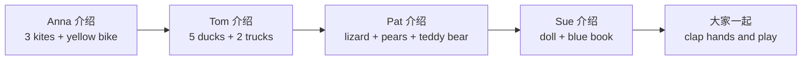

  02
  
UNIT 02 · STUDENT'S BOOK PAGES 12–19

  <h1>Come and play</h1>
  
来和我们一起玩

  

    玩具
    宠物
    颜色
    交朋友
  

> **一句话故事**：四个孩子 Anna、Tom、Pat、Sue 轮流介绍自己的玩具和宠物，最后一起拍手，邀请读者加入游戏。

## 🎯 学完能做到

<ul class="checklist">
  <li>用 <strong>I've got…</strong> 说自己有什么。</li>
  <li>用 <strong>We've got…</strong> 说“我们有……”。</li>
  <li>把名词变复数：car → cars，duck → ducks。</li>
  <li>用 <strong>Come and play!</strong> 邀请朋友一起玩。</li>
</ul>

## 📖 故事地图

  👧 Anna
  👦 Tom
  👧 Pat
  👧 Sue
  🐸 three green frogs

## 🔤 核心词汇

### 玩具

  
<b>ball</b><small>球</small>

  
<b>bat</b><small>球拍</small>

  
<b>bike</b><small>自行车</small>

  
<b>car</b><small>小汽车</small>

  
<b>doll</b><small>娃娃</small>

  
<b>guitar</b><small>吉他</small>

  
<b>kite</b><small>风筝</small>

  
<b>robot</b><small>机器人</small>

  
<b>teddy bear</b><small>泰迪熊</small>

  
<b>truck</b><small>卡车</small>

### 宠物和动物

  
<b>cat</b><small>猫</small>

  
<b>dog</b><small>狗</small>

  
<b>duck</b><small>鸭子</small>

  
<b>frog</b><small>青蛙</small>

  
<b>lizard</b><small>蜥蜴</small>

  
<b>mouse</b><small>老鼠</small>

  
<b>pet</b><small>宠物</small>

### 颜色和形容词

  
<b>green</b><small>绿色</small>

  
<b>yellow</b><small>黄色</small>

  
<b>red</b><small>红色</small>

  
<b>big</b><small>大的</small>

  
<b>funny</b><small>有趣的</small>

  
<b>happy</b><small>开心的</small>

### 其他

  
<b>book</b><small>书</small>

  
<b>bag</b><small>包</small>

  
<b>pencil</b><small>铅笔</small>

  
<b>pear</b><small>梨</small>

  
<b>hand</b><small>手</small>

  
<b>children</b><small>孩子们</small>

  
完整词汇表（来自教师用书）

Anna, bag, ball, bat, big, bike, book, car, children, doll, duck, frog, funny, green, guitar, hand, hat, kite, lizard, mouse, Pat, pear, pencil, pet, robot, Sue, teddy bear, Tom, truck, yellow

## 💬 重点句型

  
I've got three kites and a yellow bike.

  
我有三只风筝和一辆黄色自行车。

  
We've got lots of pets, too.

  
我们也有很多宠物。

  
Come and play with me today!

  
今天来和我一起玩吧！

  
Clap your hands and come and play.

  
拍拍手，来一起玩。

## 🧠 语法小课堂

| 要表达 | 句型 | 例子 |
| --- | --- | --- |
| 我有…… | I've got + 名词 | I've got a doll. |
| 我们有…… | We've got + 名词 | We've got a cat. |
| 你有……吗？ | Have you got…? | Have you got a bike? |
| 复数 | 名词 + s | car → cars；duck → ducks |

注意：<strong>a</strong> 用在单数前面，比如 a bike；复数或数量大于 1 时不用 a，比如 two cars、three kites。

## ❤️ 价值与任务

  VALUE · 交朋友
  
故事里每个孩子都说 <strong>“Come and play with me today!”</strong>，有玩具一起玩，有宠物一起认识。

  
可以问孩子：<em>What do you say when you want a friend to play with you?</em>（想邀请朋友玩时，你会怎么说？）

  
1<strong>玩具展示</strong>
选 3 个玩具，用 “I've got…” 介绍。

  
2<strong>复数接龙</strong>
看到一样东西，说一个复数：two cars, three frogs…

  
3<strong>邀请朋友</strong>
用 “Come and play with me!” 邀请家人。

## ✅ Starters 练习对应

| 题型 | 这个单元练什么 |
| --- | --- |
| Reading and Writing Part 1 | 看图判断句子对错（✓ / ×） |
| Reading and Writing Part 2 | 看图写 yes / no |
| Listening Part 4 | 听指令，给图片涂色 |
| Speaking Part 2 | 看图回答问题 |

Home Fun Booklet：<strong>Toys</strong> 第 6–7 页。

## 🔗 原书链接

- <a href="https://github.com/wangwx2019/storyfun/blob/main/MinerU_markdown_182_1-_Storyfun_1._Student%27s_book_Saxby_Karen_2017_-80p__2117270302067953664.md" target="_blank" rel="noopener">Student's Book · Come and play</a>
- <a href="https://github.com/wangwx2019/storyfun/blob/main/MinerU_markdown_182_2-_Storyfun_1._Teacher%27s_Book_Saxby_Karen_2017_-59p__2117271774566453248.md" target="_blank" rel="noopener">Teacher's Book · Unit 2 notes</a>
