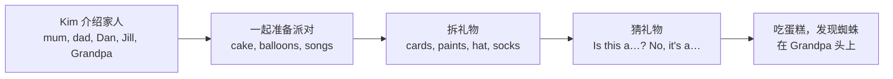

  03
  
UNIT 03 · STUDENT'S BOOK PAGES 20–27

  <h1>Kim's birthday</h1>
  
Kim 的生日

  

    家庭
    生日派对
    礼物
    感谢
  

> **一句话故事**：今天是 Kim 的八岁生日。全家人一起准备派对、拆礼物、吃蛋糕，最后发现玩具蜘蛛跑到了爷爷的头上。

## 🎯 学完能做到

<ul class="checklist">
  <li>介绍家人：This is my mum / dad / brother / sister.</li>
  <li>用 <strong>Let's…</strong> 提议一起做某事。</li>
  <li>用 <strong>How old are you?</strong> 问年龄，回答 I'm eight.</li>
  <li>用 <strong>Is this a…?</strong> 猜东西，并回答 No, it's a…</li>
</ul>

## 📖 故事地图

  👧 Kim
  👨 Dad
  👩 Mum
  👦 Dan
  👧 Jill
  👴 Grandpa Bill

## 🔤 核心词汇

### 家人

  
<b>mum</b><small>妈妈</small>

  
<b>dad</b><small>爸爸</small>

  
<b>brother</b><small>兄弟</small>

  
<b>sister</b><small>姐妹</small>

  
<b>grandma</b><small>奶奶 / 外婆</small>

  
<b>grandpa</b><small>爷爷 / 外公</small>

### 生日派对

  
<b>birthday</b><small>生日</small>

  
<b>party</b><small>派对</small>

  
<b>cake</b><small>蛋糕</small>

  
<b>balloon</b><small>气球</small>

  
<b>present</b><small>礼物</small>

  
<b>card</b><small>卡片</small>

  
<b>lemonade</b><small>柠檬水</small>

  
<b>ice cream</b><small>冰淇淋</small>

### 礼物和衣物

  
<b>paints</b><small>颜料</small>

  
<b>sun hat</b><small>遮阳帽</small>

  
<b>socks</b><small>袜子</small>

  
<b>toy tiger</b><small>玩具老虎</small>

  
<b>toy spider</b><small>玩具蜘蛛</small>

  
<b>clock</b><small>钟</small>

### 动作和祝福

  
<b>make</b><small>做</small>

  
<b>get</b><small>拿 / 取</small>

  
<b>sing</b><small>唱歌</small>

  
<b>Hooray!</b><small>好耶！</small>

  
<b>Thank you!</b><small>谢谢你！</small>

  
<b>How old…?</b><small>几岁了？</small>

  
完整词汇表（来自教师用书）

balloon, birthday, brother, cake, card, clock, dad, Dan, eight, family, food, grandpa, grandma, Jill, Kim, lemonade, mum, party, present, sister, socks, sun hat, toy spider, toy tiger, paints, ice cream, Thank you

## 💬 重点句型

  
It's my birthday today! Hooray!

  
今天是我的生日！好耶！

  
This is my mum and dad. This is my brother, Dan.

  
这是我的爸爸妈妈。这是我的哥哥 / 弟弟 Dan。

  
Let's have a party! / Let's make a big cake!

  
我们来办派对！/ 我们来做一个大蛋糕！

  
How old are you? — I'm eight.

  
你几岁了？——我八岁。

  
Is this a bat? — No, it's a sun hat.

  
这是球拍吗？——不，是遮阳帽。

## 🧠 语法小课堂

| 要表达 | 句型 | 例子 |
| --- | --- | --- |
| 某人的 | 人名 + 's | Kim's birthday / Grandpa's head |
| 提议一起做 | Let's + 动词原形 | Let's sing lots of songs! |
| 问年龄 | How old + be + 主语? | How old are you? |
| 猜东西 | Is this a + 名词? | Is this a clock? |

<strong>Let's</strong> 是 Let us 的缩写，后面直接跟动词原形：Let's <u>make</u> a cake. 不说 Let's making。

## ❤️ 价值与任务

  VALUE · 感谢
  
故事最后，Kim 说：<strong>“Thank you, Mum and Dad and Jill. And thank you, Dan and Grandpa Bill!”</strong>

  
可以问孩子：<em>Who do you want to thank today? What for?</em>（今天你想感谢谁？为什么？）

  
1<strong>家庭介绍</strong>
拿全家福，用 “This is my…” 介绍 3 个人。

  
2<strong>礼物猜猜猜</strong>
把东西放进袋子，用 “Is this a…?” 猜。

  
3<strong>派对计划</strong>
用 “Let's…” 说 3 件派对上要做的事。

## ✅ Starters 练习对应

| 题型 | 这个单元练什么 |
| --- | --- |
| Reading and Writing Part 2 | 看图读句子，写 yes / no |
| Listening Part 4 | 听指令，给派对图片涂色 |

Home Fun Booklet：<strong>Family</strong> 第 8–9 页。

## 🔗 原书链接

- <a href="https://github.com/wangwx2019/storyfun/blob/main/MinerU_markdown_182_1-_Storyfun_1._Student%27s_book_Saxby_Karen_2017_-80p__2117270302067953664.md" target="_blank" rel="noopener">Student's Book · Kim's birthday</a>
- <a href="https://github.com/wangwx2019/storyfun/blob/main/MinerU_markdown_182_2-_Storyfun_1._Teacher%27s_Book_Saxby_Karen_2017_-59p__2117271774566453248.md" target="_blank" rel="noopener">Teacher's Book · Unit 3 notes</a>
