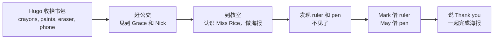

  04
  
UNIT 04 · STUDENT'S BOOK PAGES 28–35

  <h1>Hugo's school bag</h1>
  
Hugo 的书包

  

    学校
    文具
    方位
    分享
  

> **一句话故事**：Hugo 收拾好书包去上学，到了学校却发现尺子和笔不见了。幸运的是，Mark 和 May 都愿意把自己的文具分享给他。

## 🎯 学完能做到

<ul class="checklist">
  <li>说出学校里的地点和人物：classroom, playground, teacher。</li>
  <li>用 <strong>Where's my…?</strong> 问东西在哪里。</li>
  <li>用 <strong>Here's my… / Here are my…</strong> 说“这是我的……”。</li>
  <li>用 <strong>Here you are!</strong> 把东西递给别人。</li>
</ul>

## 📖 故事地图

  👦 Hugo
  👩‍🏫 Miss Rice
  👧 Grace
  👦 Nick
  👦 Mark
  👧 May

## 🔤 核心词汇

### 学校

  
<b>school</b><small>学校</small>

  
<b>classroom</b><small>教室</small>

  
<b>playground</b><small>操场</small>

  
<b>teacher</b><small>老师</small>

  
<b>lesson</b><small>课</small>

  
<b>bus stop</b><small>公交站</small>

### 文具

  
<b>school bag</b><small>书包</small>

  
<b>pen</b><small>钢笔 / 笔</small>

  
<b>pencil</b><small>铅笔</small>

  
<b>ruler</b><small>尺子</small>

  
<b>eraser</b><small>橡皮</small>

  
<b>crayons</b><small>蜡笔</small>

  
<b>paints</b><small>颜料</small>

  
<b>book</b><small>书</small>

### 动作

  
<b>run</b><small>跑</small>

  
<b>jump</b><small>跳</small>

  
<b>catch</b><small>接住</small>

  
<b>share</b><small>分享</small>

  
<b>make</b><small>做</small>

  
<b>see</b><small>看见</small>

### 形容词和名字

  
<b>new</b><small>新的</small>

  
<b>old</b><small>旧的</small>

  
<b>nice</b><small>友好的</small>

  
<b>cool</b><small>酷的</small>

  
<b>Hugo</b><small>男孩名</small>

  
<b>Sue</b><small>女孩名</small>

  
完整词汇表（来自教师用书）

bag, ball, book, bus, catch, classroom, crayons, eraser, Grace, Hugo, jump, Mark, May, Miss Rice, new, Nick, pen, pencil, phone, playground, poster, paints, ruler, school, school bag, Sue, teacher, thank you

## 💬 重点句型

  
It's a school day today! What's in my bag?

  
今天是上学的日子！我包里有什么？

  
This is my classroom. And this is Miss Rice.

  
这是我的教室。这是 Rice 老师。

  
Where is my ruler? — It's not here.

  
我的尺子在哪儿？——不在这儿。

  
What's this? — It's my new crayon.

  
这是什么？——是我的新蜡笔。

  
Here you are! Have my ruler. I've got two!

  
给你！用我的尺子吧，我有两把！

## 🧠 语法小课堂

| 要表达 | 句型 | 例子 |
| --- | --- | --- |
| 我的东西在哪？ | Where's my + 单数名词? | Where's my pen? |
| 这是我的…… | Here's my + 单数名词 | Here's my school bag. |
| 这是他的 / 她的…… | Here's his / her + 单数名词 | Here's his pen. |
| 这些是我的…… | Here are my + 复数名词 | Here are my crayons. |
| 问这是什么 | What's this? | What's this? — It's a ruler. |
| 递东西 | Here you are! | Here you are! |

区分 <strong>Here's</strong>（单数）和 <strong>Here are</strong>（复数）：Here's my pen. / Here are my pens.

## ❤️ 价值与任务

  VALUE · 分享
  
Mark 说 <strong>“Have my ruler. I've got two!”</strong>，May 说 <strong>“Have my pen. I've got three!”</strong>

  
可以问孩子：<em>What can you share with your friends?</em>（你可以和朋友分享什么？）

  
1<strong>书包盘点</strong>
用 “What's in my bag?” 介绍自己的书包。

  
2<strong>找东西</strong>
藏起一件文具，用 “Where's my…?” 找。

  
3<strong>分享练习</strong>
把文具递给家人，说 “Here you are!”

## ✅ Starters 练习对应

| 题型 | 这个单元练什么 |
| --- | --- |
| Listening Part 1 | 听名字，把人名和图中人物连线 |
| Speaking Part 1 | 指图、放卡片、说位置 |
| Speaking Part 4 | 回答关于自己的问题 |

## 📝 Home Fun 练习

学完这个单元，顺手做一页 Home Fun。先独立完成，再展开答案；点击图片可以看大图。

  

    HOME FUN
    School · 第 10–11 页
  

  
<strong>本页任务：</strong>A Put a tick or a cross. B Read, colour and write. D Listen and colour. 练习学校物品和颜色。

  

    <figure class="practice-figure">
  
  <figcaption>练习页</figcaption>
</figure>
  

  

    
做完啦，查看答案

    

      
<figure class="practice-figure">
  
  <figcaption>答案页 1</figcaption>
</figure>
<figure class="practice-figure">
  
  <figcaption>答案页 2</figcaption>
</figure>

    

  

  
原书：<a href="https://github.com/wangwx2019/storyfun/blob/main/MinerU_markdown_182_4-_Home_Fun_Booklet_1_Owen_Melissa_2017_-32p__2117271120779317248.md#L358-L456" target="_blank" rel="noopener">Home Fun Booklet · School</a> · <a href="https://github.com/wangwx2019/storyfun/blob/main/MinerU_markdown_182_5-_Home_Fun_Booklet_1._Answers_Owen_Melissa_2017_-32p__2117271459733602304.md#L272-L375" target="_blank" rel="noopener">Answers · School</a>。

  

    REVIEW
    Review · 第 12–13 页（Unit 4 加练）
  

  
<strong>本页任务：</strong>A Draw lines. B Colour the school / family / toy words. Fun at home：看图连线，讲给家人听。

  

    <figure class="practice-figure">
  
  <figcaption>练习页</figcaption>
</figure>
  

  

    
做完啦，查看答案

    

      
<figure class="practice-figure">
  
  <figcaption>答案页</figcaption>
</figure>

    

  

  
原书：<a href="https://github.com/wangwx2019/storyfun/blob/main/MinerU_markdown_182_4-_Home_Fun_Booklet_1_Owen_Melissa_2017_-32p__2117271120779317248.md#L457-L516" target="_blank" rel="noopener">Home Fun Booklet · Review</a> · <a href="https://github.com/wangwx2019/storyfun/blob/main/MinerU_markdown_182_5-_Home_Fun_Booklet_1._Answers_Owen_Melissa_2017_-32p__2117271459733602304.md#L376-L407" target="_blank" rel="noopener">Answers · Review</a>。

## 🔗 原书链接

- <a href="https://github.com/wangwx2019/storyfun/blob/main/MinerU_markdown_182_1-_Storyfun_1._Student%27s_book_Saxby_Karen_2017_-80p__2117270302067953664.md" target="_blank" rel="noopener">Student's Book · Hugo's school bag</a>
- <a href="https://github.com/wangwx2019/storyfun/blob/main/MinerU_markdown_182_2-_Storyfun_1._Teacher%27s_Book_Saxby_Karen_2017_-59p__2117271774566453248.md" target="_blank" rel="noopener">Teacher's Book · Unit 4 notes</a>
