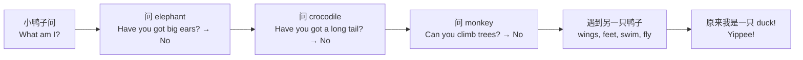

  05
  
UNIT 05 · STUDENT'S BOOK PAGES 36–43

  <h1>What am I?</h1>
  
猜猜我是什么？

  

    动物
    身体部位
    颜色
    提问
  

> **一句话故事**：一只小鸭子不知道自己是什么动物，于是去问大象、鳄鱼和猴子。最后它遇到另一只鸭子，才发现：“原来我是一只鸭子！”

## 🎯 学完能做到

<ul class="checklist">
  <li>说出常见动物和身体部位：elephant, crocodile, monkey, tail, wings。</li>
  <li>用 <strong>Can you…?</strong> 问会不会做某事。</li>
  <li>用 <strong>Yes, I can. / No, I can't.</strong> 回答。</li>
  <li>用 <strong>I've got…</strong> 描述身体特征。</li>
</ul>

## 📖 故事地图

  🦆 duck
  🐘 elephant
  🐊 crocodile
  🐒 monkey

## 🔤 核心词汇

### 动物

  
<b>duck</b><small>鸭子</small>

  
<b>elephant</b><small>大象</small>

  
<b>crocodile</b><small>鳄鱼</small>

  
<b>monkey</b><small>猴子</small>

  
<b>frog</b><small>青蛙</small>

  
<b>bird</b><small>鸟</small>

### 身体部位

  
<b>body</b><small>身体</small>

  
<b>head</b><small>头</small>

  
<b>face</b><small>脸</small>

  
<b>ear</b><small>耳朵</small>

  
<b>eye</b><small>眼睛</small>

  
<b>nose</b><small>鼻子</small>

  
<b>mouth</b><small>嘴巴</small>

  
<b>teeth</b><small>牙齿</small>

  
<b>tail</b><small>尾巴</small>

  
<b>wing / wings</b><small>翅膀</small>

  
<b>foot / feet</b><small>脚</small>

  
<b>leg</b><small>腿</small>

### 形容词

  
<b>big</b><small>大的</small>

  
<b>small</b><small>小的</small>

  
<b>long</b><small>长的</small>

  
<b>short</b><small>短的</small>

  
<b>funny</b><small>滑稽的</small>

  
<b>brown</b><small>棕色</small>

  
<b>yellow</b><small>黄色</small>

### 动作

  
<b>swim</b><small>游泳</small>

  
<b>walk</b><small>走路</small>

  
<b>fly</b><small>飞</small>

  
<b>climb</b><small>爬</small>

  
<b>tell</b><small>告诉</small>

  
<b>ask</b><small>问</small>

  
完整词汇表（来自教师用书）

animal, body, brown, can, climb, crocodile, duck, ear, elephant, eye, face, feet, fly, foot, frog, funny, head, leg, long, monkey, mouth, nose, short, small, swim, tail, teeth, walk, wing, yellow

## 💬 重点句型

  
What am I? Can you tell me, please?

  
我是什么？你能告诉我吗？

  
Have you got big ears? — No, I haven't.

  
你有大耳朵吗？——不，我没有。

  
Can you climb trees? — No, I can't.

  
你会爬树吗？——不，我不会。

  
I can swim. I can walk and I can fly.

  
我会游泳，会走路，也会飞。

  
You're a duck, you see! You're a duck like me!

  
你看，你是一只鸭子！你和我一样是鸭子！

## 🧠 语法小课堂

| 要表达 | 句型 | 例子 |
| --- | --- | --- |
| 一个 / 一只 | a + 辅音开头；an + 元音开头 | a duck / an elephant |
| 会做某事 | can + 动词原形 | I can swim. |
| 不会做某事 | can't + 动词原形 | I can't climb trees. |
| 问会不会 | Can you + 动词原形? | Can you fly? |

注意：<strong>can</strong> 后面的动词不用加 s 或 ing：I can <u>swim</u>. 不说 I can swimming。

## ❤️ 价值与任务

  VALUE · 提问是好事
  
小鸭子一路都在问：<strong>“Please tell me!”</strong> 问大象、问鳄鱼、问猴子，最后找到了答案。

  
可以问孩子：<em>What questions do you like to ask?</em>（你喜欢问什么问题？）

  
1<strong>动物猜猜猜</strong>
描述一种动物，让对方用 “Is it a…?” 猜。

  
2<strong>我会做</strong>
用 “I can…” 说 3 件自己会做的事。

  
3<strong>身体部位</strong>
指着自己或玩偶，说 head, ear, tail…

## ✅ Starters 练习对应

| 题型 | 这个单元练什么 |
| --- | --- |
| Reading and Writing Part 3 | 看字母重组，写动物单词 |
| Listening Part 4 | 听指令，给动物图片涂色 |
| Speaking Part 4 | 回答关于自己的问题 |

## 📝 Home Fun 练习

学完这个单元，顺手做一页 Home Fun。先独立完成，再展开答案；点击图片可以看大图。

  

    HOME FUN
    Animals · 第 14–15 页
  

  
<strong>本页任务：</strong>A Look and write（字母重组）. B Look, read and write（can / can't）. Fun at home：描述动物，让对方猜。

  

    <figure class="practice-figure">
  
  <figcaption>练习页</figcaption>
</figure>
  

  

    
做完啦，查看答案

    

      
<strong>A Look and write（字母重组）</strong>

<ul>
  <li>ogd → <strong>dog</strong></li>
  <li>ethpelan → <strong>elephant</strong></li>
  <li>ihopp → <strong>hippo</strong></li>
  <li>mnoeky → <strong>monkey</strong></li>
  <li>codricole → <strong>crocodile</strong></li>
  <li>dkcu → <strong>duck</strong></li>
</ul>

<strong>B Look, read and write（参考答案）</strong>

<table>
  <thead><tr><th>动物</th><th>can</th><th>can't</th></tr></thead>
  <tbody>
    <tr><td>monkey</td><td>jump, run</td><td>swim, fly</td></tr>
    <tr><td>elephant</td><td>swim, run</td><td>jump, fly</td></tr>
    <tr><td>duck</td><td>swim, fly</td><td>jump, run</td></tr>
    <tr><td>crocodile</td><td>swim, run</td><td>jump, fly</td></tr>
  </tbody>
</table>

<strong>Fun at home</strong>：想一种动物，用 <em>I am … / I can … / I can't …</em> 描述，让对方猜。

B 部分为参考；Animals 的完整答案页在原书 Answers 中只保留了局部截图，可点上面的原书链接核对。

    

  

  
原书：<a href="https://github.com/wangwx2019/storyfun/blob/main/MinerU_markdown_182_4-_Home_Fun_Booklet_1_Owen_Melissa_2017_-32p__2117271120779317248.md#L517-L611" target="_blank" rel="noopener">Home Fun Booklet · Animals</a> · <a href="https://github.com/wangwx2019/storyfun/blob/main/MinerU_markdown_182_5-_Home_Fun_Booklet_1._Answers_Owen_Melissa_2017_-32p__2117271459733602304.md#L408-L502" target="_blank" rel="noopener">Answers · Animals</a>。

## 🔗 原书链接

- <a href="https://github.com/wangwx2019/storyfun/blob/main/MinerU_markdown_182_1-_Storyfun_1._Student%27s_book_Saxby_Karen_2017_-80p__2117270302067953664.md" target="_blank" rel="noopener">Student's Book · What am I?</a>
- <a href="https://github.com/wangwx2019/storyfun/blob/main/MinerU_markdown_182_2-_Storyfun_1._Teacher%27s_Book_Saxby_Karen_2017_-59p__2117271774566453248.md" target="_blank" rel="noopener">Teacher's Book · Unit 5 notes</a>
