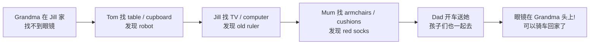

  06
  
UNIT 06 · STUDENT'S BOOK PAGES 44–51

  <h1>Grandma's glasses</h1>
  
奶奶的眼镜

  

    家
    家具
    方位介词
    帮忙
  

> **一句话故事**：奶奶在 Jill 家找不到眼镜，全家人分头找：桌子、柜子、电视、电脑、沙发……最后发现眼镜一直戴在奶奶头上。

## 🎯 学完能做到

<ul class="checklist">
  <li>说出家里的物品：table, cupboard, TV, computer, armchair, cushion。</li>
  <li>用 <strong>on / in / under / next to</strong> 说东西在哪里。</li>
  <li>用 <strong>Where are my…?</strong> 问复数物品的位置。</li>
  <li>用 <strong>I can help! / Let's look…</strong> 主动帮忙。</li>
</ul>

## 📖 故事地图

  👵 Grandma
  👩 Mum
  👨 Dad
  👧 Jill
  👦 Tom

## 🔤 核心词汇

### 家和家具

  
<b>home</b><small>家</small>

  
<b>house</b><small>房子</small>

  
<b>table</b><small>桌子</small>

  
<b>cupboard</b><small>柜子</small>

  
<b>TV</b><small>电视</small>

  
<b>computer</b><small>电脑</small>

  
<b>armchair</b><small>扶手椅</small>

  
<b>cushion</b><small>靠垫</small>

### 衣物和随身物品

  
<b>glasses</b><small>眼镜</small>

  
<b>handbag</b><small>手提包</small>

  
<b>coat</b><small>外套</small>

  
<b>toothbrush</b><small>牙刷</small>

  
<b>socks</b><small>袜子</small>

  
<b>bike</b><small>自行车</small>

### 方位词

  
<b>on</b><small>在……上面</small>

  
<b>in</b><small>在……里面</small>

  
<b>under</b><small>在……下面</small>

  
<b>next to</b><small>在……旁边</small>

  
<b>here</b><small>这里</small>

  
<b>where</b><small>哪里</small>

### 动作

  
<b>look</b><small>看 / 找</small>

  
<b>find</b><small>找到</small>

  
<b>help</b><small>帮忙</small>

  
<b>ride</b><small>骑</small>

  
<b>drive</b><small>开车</small>

  
<b>come</b><small>来</small>

  
完整词汇表（来自教师用书）

armchair, bike, can, coat, come, computer, cupboard, Dad, drive, find, glasses, Grandma, handbag, help, home, house, in, Jill, look, Mum, next to, on, ride, socks, table, Tom, toothbrush, TV, under, where

## 💬 重点句型

  
I can help!

  
我可以帮忙！

  
Where are my glasses?

  
我的眼镜在哪儿？

  
Let's look on the table and in the cupboard, too.

  
我们看看桌子上，也看看柜子里。

  
They aren't here. But look! My old ruler!

  
它们不在这儿。但是看！我的旧尺子！

  
Your glasses are on your head!

  
你的眼镜就在你头上！

## 🧠 语法小课堂

| 要表达 | 句型 | 例子 |
| --- | --- | --- |
| 在……上面 | on | on the table |
| 在……里面 | in | in the cupboard |
| 在……下面 | under | under the TV |
| 在……旁边 | next to | next to the computer |
| 问复数物品在哪 | Where are + 复数? | Where are my glasses? |

<strong>glasses</strong>（眼镜）是复数，所以用 <strong>are / they</strong>：Where are my glasses? — They're on your head.

## ❤️ 价值与任务

  VALUE · 帮助别人
  
Tom 说 <strong>“I can help!”</strong>，全家人一起找。虽然没找到眼镜，却找到了 robot、ruler、socks，也找到了帮忙的乐趣。

  
可以问孩子：<em>How can you help at home?</em>（你在家可以帮什么忙？）

  
1<strong>藏眼镜</strong>
藏一个物品，用 “Where is…?” 找。

  
2<strong>方位指令</strong>
把玩具放在 on / in / under / next to 的位置。

  
3<strong>帮忙清单</strong>
说 3 件自己在家能帮忙做的事。

## ✅ Starters 练习对应

| 题型 | 这个单元练什么 |
| --- | --- |
| Reading and Writing Part 3 | 看字母重组，写房间物品单词 |
| Reading and Writing Part 5 | 看三幅图，用一两个词回答问题 |
| Listening Part 4 | 听指令，给图片涂色 |
| Speaking Part 1 | 指图、放卡片、说位置 |

## 📝 Home Fun 练习

学完这个单元，顺手做一页 Home Fun。先独立完成，再展开答案；点击图片可以看大图。

  

    HOME FUN
    Home · 第 16–17 页
  

  
<strong>本页任务：</strong>A Circle the correct answer. B Draw your toy and write. C Count and write. D What's in your house?

  

    <figure class="practice-figure">
  
  <figcaption>练习页</figcaption>
</figure>
  

  

    
做完啦，查看答案

    

      
<strong>A Circle the correct answer（参考答案）</strong>

<ol>
  <li>The robot is <strong>under</strong> the table.</li>
  <li>The robot is <strong>on</strong> the armchair.</li>
  <li>The robot is <strong>in</strong> the cupboard.</li>
  <li>The robot is <strong>next to</strong> the computer.</li>
</ol>

<strong>C Count and write</strong>

<ol>
  <li>Jill has got <strong>five lamps</strong>.</li>
  <li>Jill has got <strong>three sofas</strong>.</li>
  <li>Jill has got <strong>two tables</strong>.</li>
  <li>Jill has got <strong>four chairs</strong>.</li>
</ol>

<strong>B / D</strong>：画自己的玩具或房间，答案是开放的。可以让孩子用 <em>I've got a … It's on / in / under / next to the …</em> 说一说。

A 部分为参考答案，以原书答案页的圈选为准。B / D 没有唯一答案。

    

  

  
原书：<a href="https://github.com/wangwx2019/storyfun/blob/main/MinerU_markdown_182_4-_Home_Fun_Booklet_1_Owen_Melissa_2017_-32p__2117271120779317248.md#L612-L758" target="_blank" rel="noopener">Home Fun Booklet · Home</a> · <a href="https://github.com/wangwx2019/storyfun/blob/main/MinerU_markdown_182_5-_Home_Fun_Booklet_1._Answers_Owen_Melissa_2017_-32p__2117271459733602304.md#L503-L661" target="_blank" rel="noopener">Answers · Home</a>。

## 🔗 原书链接

- <a href="https://github.com/wangwx2019/storyfun/blob/main/MinerU_markdown_182_1-_Storyfun_1._Student%27s_book_Saxby_Karen_2017_-80p__2117270302067953664.md" target="_blank" rel="noopener">Student's Book · Grandma's glasses</a>
- <a href="https://github.com/wangwx2019/storyfun/blob/main/MinerU_markdown_182_2-_Storyfun_1._Teacher%27s_Book_Saxby_Karen_2017_-59p__2117271774566453248.md" target="_blank" rel="noopener">Teacher's Book · Unit 6 notes</a>
