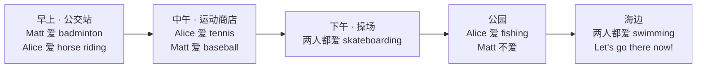

  07
  
UNIT 07 · STUDENT'S BOOK PAGES 52–59

  <h1>Let's go there now!</h1>
  
现在就去那儿！

  

    运动
    地点
    时间
    喜好
  

> **一句话故事**：Matt 和 Alice 从早上到下午一直在聊运动。他们喜欢的项目不一样，但最后发现：两人都爱滑板和游泳。

## 🎯 学完能做到

<ul class="checklist">
  <li>说出 8 种运动：badminton, baseball, basketball, football, fishing, horse riding, skateboarding, swimming。</li>
  <li>用 <strong>Do you like…?</strong> 问喜好。</li>
  <li>用 <strong>Yes, I do. / No, I don't.</strong> 回答。</li>
  <li>用 <strong>Which…? / Who…?</strong> 问“哪一个 / 谁”。</li>
</ul>

## 📖 故事地图

  👦 Matt
  👧 Alice
  🏖️ Sea Street
  🛹 red / grey skateboard

## 🔤 核心词汇

### 运动

  
<b>badminton</b><small>羽毛球</small>

  
<b>baseball</b><small>棒球</small>

  
<b>basketball</b><small>篮球</small>

  
<b>football</b><small>足球</small>

  
<b>fishing</b><small>钓鱼</small>

  
<b>horse riding</b><small>骑马</small>

  
<b>skateboarding</b><small>滑板</small>

  
<b>swimming</b><small>游泳</small>

  
<b>tennis</b><small>网球</small>

  
<b>table tennis</b><small>乒乓球</small>

### 地点

  
<b>beach</b><small>海滩</small>

  
<b>park</b><small>公园</small>

  
<b>playground</b><small>操场</small>

  
<b>sports shop</b><small>运动用品店</small>

  
<b>bus stop</b><small>公交站</small>

  
<b>Sea Street</b><small>海街</small>

### 时间

  
<b>morning</b><small>早上</small>

  
<b>lunchtime</b><small>午餐时间</small>

  
<b>afternoon</b><small>下午</small>

  
<b>today</b><small>今天</small>

  
<b>now</b><small>现在</small>

### 动作和喜好

  
<b>like</b><small>喜欢</small>

  
<b>love</b><small>热爱</small>

  
<b>go</b><small>去</small>

  
<b>ride</b><small>骑</small>

  
<b>skateboard</b><small>滑板</small>

  
<b>which</b><small>哪一个</small>

  
<b>who</b><small>谁</small>

  
完整词汇表（来自教师用书）

afternoon, Alice, badminton, baseball, basketball, beach, bus stop, father, fishing, football, go, horse riding, like, love, lunchtime, Matt, morning, park, playground, ride, skateboard, skateboarding, sports shop, swimming, table tennis, tennis, which, who

## 💬 重点句型

  
Do you like badminton? — No, I don't.

  
你喜欢羽毛球吗？——不，我不喜欢。

  
I love tennis. Do you?

  
我热爱网球。你呢？

  
Which is your skateboard? — The red one.

  
哪一块是你的滑板？——红色的那块。

  
Who likes horse riding?

  
谁喜欢骑马？

  
Let's go there now!

  
我们现在就去那儿吧！

## 🧠 语法小课堂

| 要表达 | 句型 | 例子 |
| --- | --- | --- |
| 问喜好 | Do you like + 名词 / 动名词? | Do you like swimming? |
| 喜欢 | Yes, I do. | Yes, I do. |
| 不喜欢 | No, I don't. | No, I don't. |
| 问哪一个 | Which + 名词 + be + 主语? | Which is your skateboard? |
| 问谁 | Who + 动词? | Who likes fishing? |

回答 <strong>Do you like…?</strong> 时，用 do / don't，不用 am / aren't：Yes, I <u>do</u>. / No, I <u>don't</u>.

## ❤️ 价值与任务

  VALUE · 接受不同，也找到共同点
  
Matt 和 Alice 有很多不一样的喜好，但他们没有争谁对谁错，最后一起找到了都爱的滑板和游泳。

  
可以问孩子：<em>What do you like? What does your friend like?</em>（你喜欢什么？你的朋友喜欢什么？）

  
1<strong>喜好调查</strong>
问家人 3 个 “Do you like…?” 并记录答案。

  
2<strong>运动模仿</strong>
做动作，让对方猜运动名称。

  
3<strong>共同点</strong>
找出你和朋友都喜欢的 2 件事。

## ✅ Starters 练习对应

| 题型 | 这个单元练什么 |
| --- | --- |
| Listening Part 2 | 听数字和名字拼写 |
| Speaking Part 3 | 回答关于物品卡片的问题 |

## 📝 Home Fun 练习

学完这个单元，顺手做一页 Home Fun。先独立完成，再展开答案；点击图片可以看大图。

  

    HOME FUN
    Sports · 第 18–19 页
  

  
<strong>本页任务：</strong>B Look and write. Listen and draw lines. 练习运动词汇和喜好表达。

  

    <figure class="practice-figure">
  
  <figcaption>练习页</figcaption>
</figure>
  

  

    
做完啦，查看答案

    

      
<figure class="practice-figure">
  
  <figcaption>答案页 1</figcaption>
</figure>
<figure class="practice-figure">
  
  <figcaption>答案页 2</figcaption>
</figure>

    

  

  
原书：<a href="https://github.com/wangwx2019/storyfun/blob/main/MinerU_markdown_182_4-_Home_Fun_Booklet_1_Owen_Melissa_2017_-32p__2117271120779317248.md#L759-L801" target="_blank" rel="noopener">Home Fun Booklet · Sports</a> · <a href="https://github.com/wangwx2019/storyfun/blob/main/MinerU_markdown_182_5-_Home_Fun_Booklet_1._Answers_Owen_Melissa_2017_-32p__2117271459733602304.md#L662-L710" target="_blank" rel="noopener">Answers · Sports</a>。

## 🔗 原书链接

- <a href="https://github.com/wangwx2019/storyfun/blob/main/MinerU_markdown_182_1-_Storyfun_1._Student%27s_book_Saxby_Karen_2017_-80p__2117270302067953664.md" target="_blank" rel="noopener">Student's Book · Let's go there now!</a>
- <a href="https://github.com/wangwx2019/storyfun/blob/main/MinerU_markdown_182_2-_Storyfun_1._Teacher%27s_Book_Saxby_Karen_2017_-59p__2117271774566453248.md" target="_blank" rel="noopener">Teacher's Book · Unit 7 notes</a>
