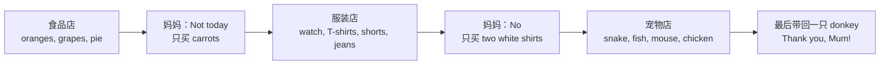

  08
  
UNIT 08 · STUDENT'S BOOK PAGES 60–67

  <h1>Not today!</h1>
  
今天不行！

  

    食物
    衣服
    动物
    购物
  

> **一句话故事**：Dan 和 Lucy 跟着妈妈逛食品店、服装店和宠物店。他们什么都想要，妈妈总说 “Not today!” 最后，他们带回了一只又酷又搞笑的驴。

## 🎯 学完能做到

<ul class="checklist">
  <li>说出食物、衣服和动物类单词。</li>
  <li>用 <strong>Can I / we have…?</strong> 礼貌地请求。</li>
  <li>用 <strong>Yes, you can. / No, you can't.</strong> 回答。</li>
  <li>用 <strong>What's this? / What are these?</strong> 问单数和复数。</li>
  <li>用 <strong>and / but / or</strong> 连接句子。</li>
</ul>

## 📖 故事地图

  👦 Dan
  👧 Lucy
  👩 Mum
  🛒 Mr Chip's food shop
  🐴 donkey

## 🔤 核心词汇

### 食物

  
<b>apple</b><small>苹果</small>

  
<b>orange</b><small>橙子</small>

  
<b>grape</b><small>葡萄</small>

  
<b>carrot</b><small>胡萝卜</small>

  
<b>tomato</b><small>西红柿</small>

  
<b>apple pie</b><small>苹果派</small>

  
<b>meatballs</b><small>肉丸</small>

  
<b>chicken</b><small>鸡肉 / 鸡</small>

  
<b>fish</b><small>鱼</small>

  
<b>rice</b><small>米饭</small>

### 衣服

  
<b>T-shirt</b><small>T 恤</small>

  
<b>shirt</b><small>衬衫</small>

  
<b>shorts</b><small>短裤</small>

  
<b>jeans</b><small>牛仔裤</small>

  
<b>watch</b><small>手表</small>

### 动物

  
<b>snake</b><small>蛇</small>

  
<b>mouse</b><small>老鼠</small>

  
<b>chicken</b><small>鸡</small>

  
<b>donkey</b><small>驴</small>

  
<b>fish</b><small>鱼</small>

### 购物和动作

  
<b>shop</b><small>商店</small>

  
<b>food shop</b><small>食品店</small>

  
<b>clothes shop</b><small>服装店</small>

  
<b>pet shop</b><small>宠物店</small>

  
<b>buy</b><small>买</small>

  
<b>get</b><small>拿 / 买</small>

  
<b>have</b><small>有 / 要</small>

  
<b>love</b><small>爱</small>

  
完整词汇表（来自教师用书）

apple, apple pie, carrots, chicken, chips, clothes shop, donkey, egg, fish, food shop, fruit, grapes, jeans, kiwi, lemon, meatballs, mouse, orange, pet shop, pie, rice, shirt, shorts, snake, sweets, T-shirt, tomato, watch

## 💬 重点句型

  
Can we have some oranges or some nice red grapes, Mum?

  
妈妈，我们可以买些橙子或者红葡萄吗？

  
Not today. We've got a lot of fruit at home.

  
今天不行。我们家里有很多水果了。

  
Can I have one of these T-shirts?

  
我可以买一件这样的 T 恤吗？

  
What's this? What are these?

  
这是什么？这些是什么？

  
Can we have a donkey, then? — Thank you, Mum!

  
那我们可以要一只驴吗？——谢谢你，妈妈！

## 🧠 语法小课堂

| 要表达 | 句型 | 例子 |
| --- | --- | --- |
| 请求许可 | Can I / we have…? | Can I have a watch? |
| 同意 | Yes, you can. | Yes, you can. |
| 不同意 | No, you can't. | No, you can't. |
| 问单数 | What's this? | What's this? |
| 问复数 | What are these? | What are these? |
| 连接 | and / but / or | apples and oranges；not today, but… |

<strong>this</strong> 指一个东西，<strong>these</strong> 指多个东西。回答时也要注意：It's a… / They're…。

## ❤️ 价值与任务

  VALUE · 学会说 Sorry / 接受“今天不行”
  
妈妈一次次说 <strong>“Not today.”</strong>，孩子们也会说 <strong>“Sorry!”</strong>。想要的东西不一定马上得到，但可以好好说。

  
可以问孩子：<em>What do you say when Mum says “Not today”?</em>（妈妈说“今天不行”时，你会怎么说？）

  
1<strong>家庭商店</strong>
把家里的东西分类成 food / clothes / pets 三个店。

  
2<strong>购物对话</strong>
用 “Can I have…?” 和 “Yes, you can. / No, you can't.” 玩买卖。

  
3<strong>单数复数</strong>
指着一个和多个东西，问 “What's this? / What are these?”

## ✅ Starters 练习对应

| 题型 | 这个单元练什么 |
| --- | --- |
| Reading and Writing Part 2 | 看图读句子，写 yes / no |
| Reading and Writing Part 4 | 看图片和短文，填一个名词 |
| Listening Part 1 | 听名字，把人名和人物连线 |

## 📝 Home Fun 练习

学完这个单元，顺手做一组 Home Fun。先独立完成，再展开答案；点击图片可以看大图，也可以直接打开原书 PDF 对照或打印。

  

    HOME FUN
    Food · 第 20–21 页
  

  
<strong>本组任务：</strong>A Read and draw lines. B Draw your food and write. My shopping list. Fun at home: Make a spinner.

  

    <figure class="practice-figure">
      
      <figcaption>练习页 · 第 20 页</figcaption>
    </figure>
    <figure class="practice-figure">
      
      <figcaption>练习页 · 第 21 页</figcaption>
    </figure>
  

  
<a class="btn btn-ghost" href="assets/pdf/home-fun-booklet-1.pdf#page=22" target="_blank" rel="noopener">练习 PDF · 书页 20–21（PDF 第 22–23 页）</a>

  

    
做完啦，查看答案

    

      

    <figure class="practice-figure">
      
      <figcaption>答案页 · 第 20 页</figcaption>
    </figure>
    <figure class="practice-figure">
      
      <figcaption>答案页 · 第 21 页</figcaption>
    </figure>
      

      
<a class="btn btn-ghost" href="assets/pdf/home-fun-answers-1.pdf#page=20" target="_blank" rel="noopener">答案 PDF · 书页 20–21（PDF 第 20–21 页）</a>

      
答案页里的 “Student's own answers” 表示开放题，孩子自己的回答就是正确答案。

    

  

  
原书：<a href="https://github.com/wangwx2019/storyfun/blob/main/MinerU_markdown_182_4-_Home_Fun_Booklet_1_Owen_Melissa_2017_-32p__2117271120779317248.md#L802-L897" target="_blank" rel="noopener">Home Fun Booklet · Food</a> · <a href="https://github.com/wangwx2019/storyfun/blob/main/MinerU_markdown_182_5-_Home_Fun_Booklet_1._Answers_Owen_Melissa_2017_-32p__2117271459733602304.md#L711-L776" target="_blank" rel="noopener">Answers · Food</a>。

  

    REVIEW
    Review 2 · 第 22–23 页（全书复习）
  

  
<strong>本组任务：</strong>A Read, write and colour. B Where are you? Draw you and your family. Fun at home: Write five words. Play the game!

  

    <figure class="practice-figure">
      
      <figcaption>练习页 · 第 22 页</figcaption>
    </figure>
    <figure class="practice-figure">
      
      <figcaption>练习页 · 第 23 页</figcaption>
    </figure>
  

  
<a class="btn btn-ghost" href="assets/pdf/home-fun-booklet-1.pdf#page=24" target="_blank" rel="noopener">练习 PDF · 书页 22–23（PDF 第 24–25 页）</a>

  

    
做完啦，查看答案

    

      

    <figure class="practice-figure">
      
      <figcaption>答案页 · 第 22 页</figcaption>
    </figure>
    <figure class="practice-figure">
      
      <figcaption>答案页 · 第 23 页</figcaption>
    </figure>
      

      
<a class="btn btn-ghost" href="assets/pdf/home-fun-answers-1.pdf#page=22" target="_blank" rel="noopener">答案 PDF · 书页 22–23（PDF 第 22–23 页）</a>

      
答案页里的 “Student's own answers” 表示开放题，孩子自己的回答就是正确答案。

    

  

  
原书：<a href="https://github.com/wangwx2019/storyfun/blob/main/MinerU_markdown_182_4-_Home_Fun_Booklet_1_Owen_Melissa_2017_-32p__2117271120779317248.md#L898-L964" target="_blank" rel="noopener">Home Fun Booklet · Review 2</a> · <a href="https://github.com/wangwx2019/storyfun/blob/main/MinerU_markdown_182_5-_Home_Fun_Booklet_1._Answers_Owen_Melissa_2017_-32p__2117271459733602304.md#L777-L835" target="_blank" rel="noopener">Answers · Review 2</a>。

  

    BONUS
    Let's have fun! · 第 24–25 页（全书拓展）
  

  
<strong>本组任务：</strong>A Ask your friend three questions. Make a video. B Where can you help? Draw lines. C Take photos of three signs you see in English. D What's the first letter? Write and draw the toys.

  

    <figure class="practice-figure">
      
      <figcaption>练习页 · 第 24 页</figcaption>
    </figure>
    <figure class="practice-figure">
      
      <figcaption>练习页 · 第 25 页</figcaption>
    </figure>
  

  
<a class="btn btn-ghost" href="assets/pdf/home-fun-booklet-1.pdf#page=26" target="_blank" rel="noopener">练习 PDF · 书页 24–25（PDF 第 26–27 页）</a>

  

    
做完啦，查看答案

    

      

    <figure class="practice-figure">
      
      <figcaption>答案页 · 第 24 页</figcaption>
    </figure>
    <figure class="practice-figure">
      
      <figcaption>答案页 · 第 25 页</figcaption>
    </figure>
      

      
<a class="btn btn-ghost" href="assets/pdf/home-fun-answers-1.pdf#page=24" target="_blank" rel="noopener">答案 PDF · 书页 24–25（PDF 第 24–25 页）</a>

      
答案页里的 “Student's own answers” 表示开放题，孩子自己的回答就是正确答案。

    

  

  
原书：<a href="https://github.com/wangwx2019/storyfun/blob/main/MinerU_markdown_182_4-_Home_Fun_Booklet_1_Owen_Melissa_2017_-32p__2117271120779317248.md#L965-L1161" target="_blank" rel="noopener">Home Fun Booklet · Let's have fun!</a> · <a href="https://github.com/wangwx2019/storyfun/blob/main/MinerU_markdown_182_5-_Home_Fun_Booklet_1._Answers_Owen_Melissa_2017_-32p__2117271459733602304.md#L836-L1017" target="_blank" rel="noopener">Answers · Let's have fun!</a>。

## 🔗 原书链接

- <a href="https://github.com/wangwx2019/storyfun/blob/main/MinerU_markdown_182_1-_Storyfun_1._Student%27s_book_Saxby_Karen_2017_-80p__2117270302067953664.md" target="_blank" rel="noopener">Student's Book · Not today!</a>
- <a href="https://github.com/wangwx2019/storyfun/blob/main/MinerU_markdown_182_2-_Storyfun_1._Teacher%27s_Book_Saxby_Karen_2017_-59p__2117271774566453248.md" target="_blank" rel="noopener">Teacher's Book · Unit 8 notes</a>
